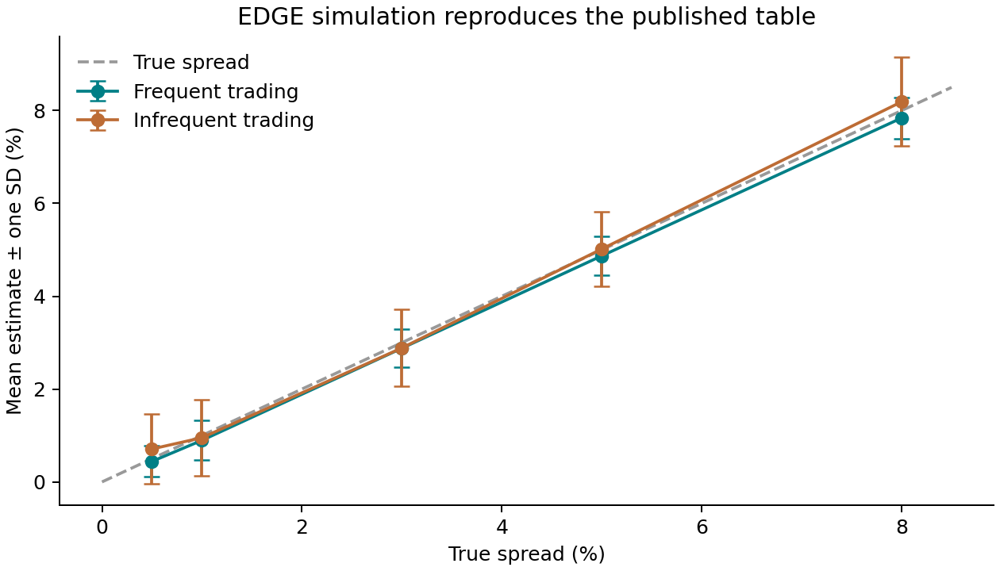
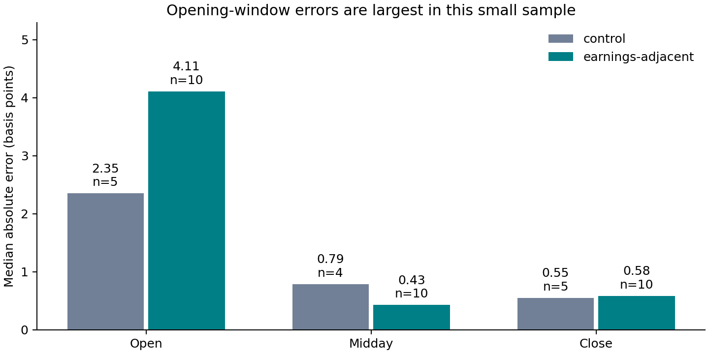

# EDGE: simulation replication and market-state pilot

MGT 6785 · Implementation completed 15 October 2026 · Measurement period: January–June 2024

## Findings

The bounded project is implemented end to end. The original Table 2 simulation is reproduced; the daily experiment has 30 matched stock-months; the intraday extension has 44 accepted intervals from 45 candidates. **The simulation succeeds, but the five-stock daily empirical pilot shows weak agreement with the high-frequency benchmark.** This is a result, not a reason to change the sample or hide zero estimates.

| Workstream | Evidence | Result |
|---|---|---|
| Simulation | 100,000 simulated 21-day windows, eight methods | 160/160 published mean/SD cells and 240/240 author-package cells match at printed precision |
| Daily empirical | 620 common-stock days, five companies, six calendar months | 30/30 stock-months matched; Pearson r = 0.0304; linear-spread RMSE = 37.983 bps |
| Intraday pilot | MSFT, 31 January 2024, full-day raw-trade download | Three 30-minute intervals; quote matching >99.6% in each |
| Market-state extension | 15 stock-days, three intervals each | 44/45 accepted; 30 valid minute bars in every candidate interval |

## 1. Question and literature

Can daily open, high, low and close prices recover transaction-cost information that normally requires intraday trades and quotes? Ardia, Guidotti and Kroencke (2024) combine OHLC-based spread moments into EDGE to improve estimation efficiency. This project first checks the implementation under the authors' known-spread simulation, then compares daily and intraday estimates against aligned high-frequency benchmarks.

The empirical analysis is intentionally a small pilot, not a reproduction of the paper's full stock universe. The extension asks whether estimation errors differ across opening, midday and closing windows and earnings-adjacent versus control sessions. It does not estimate a causal effect of earnings on liquidity.

## 2. Simulation: a verified reproduction

The original R code uses 390 potential trades per day, 21-day windows, daily volatility 3%, true spreads 0.5%, 1%, 3%, 5% and 8%, and observation probabilities 1 and 0.01. Each panel resets seed 123 and then processes spreads in the original order. The author package is pinned to its original commit; signed estimates are truncated at zero.

| True spread = 1% | Published EDGE mean | Reproduced mean | Published SD | Reproduced SD |
|---|---:|---:|---:|---:|
| Frequent trading | 0.90% | 0.896069% | 0.42% | 0.423427% |
| Infrequent trading | 0.95% | 0.952351% | 0.83% | 0.826382% |

Error bars show one simulation standard deviation, not confidence intervals. Infrequent trading increases dispersion. The published paper's Table 2 was checked separately from the supplied ZIP; all 160 printed means and SDs agree. Zero-fraction checks refer only to the author's accompanying tables. Synthetic unit fixtures also confirm positive and negative signed estimates agree between the pinned R and Python implementations within 1e-12.

## 3. Daily data and empirical comparison

The sample is AAPL, MSFT, JPM, XOM and NVDA from 1 January to 30 June 2024. CRSP annual CIZ provides 620 observations, 124 per company. All retained records satisfy the documented common-share rules and OHLC checks. Prices are split adjusted, including NVDA's June 10-for-1 split. The WRDS IID extract initially has 1,364 records; removing 744 preferred-share suffix records leaves the same 620 common-stock days. Each stock-month has 19–22 observations, with complete daily overlap.

| Pooled stock-day descriptive statistic | Mean | Median |
|---|---:|---:|
| Split-adjusted closing price, USD | 196.73 | 174.77 |
| Actual share volume, millions | 39.39 | 21.61 |
| Unadjusted dollar turnover, USD billions | 13.13 | 7.50 |
| Daily high–low range / close | 2.074% | 1.672% |

These are pooled descriptive statistics; split-adjusted price levels and raw share volume have different adjustment bases. Dollar turnover uses the unadjusted closing price.

The benchmark is the monthly RMS of positive daily `EffectiveSpread_Percent_Ave` values after a within-month one-sided 99.5% cap. The field is stored as a decimal ratio. The cap uses this five-stock sample, not the paper's entire cross-section. EDGE uses independent calendar-month windows and the signed-then-zero transformation.

Across 30 matched months, Pearson correlation is **0.0304** and linear-spread RMSE is **37.983 basis points**. Sixteen monthly EDGE estimates are truncated to zero. Large estimates in other months dominate the error. The complete monthly EDGE vector was independently recomputed with the author's R implementation, agreeing with Python within 1.1e-16. Thus the weak relationship is not explained by an R/Python formula mismatch. Short monthly windows, small true spreads, volatility and the restricted cross-section are plausible limitations; this experiment does not isolate their contributions.

The required stock-month scatterplot and underlying comparison tables are retained locally under `private_outputs/daily/`. This public report contains aggregate statistics only.

## 4. Event selection and raw-data construction

| Company | Verified announcement | Control session | Earnings-adjacent sessions |
|---|---|---|---|
| MSFT | 30 Jan 2024 | 23 Jan | 29 Jan, 31 Jan |
| AAPL | 1 Feb 2024 | 25 Jan | 31 Jan, 2 Feb |
| XOM | 2 Feb 2024 | 26 Jan | 1 Feb, 2 Feb |
| JPM | 12 Jan 2024 | 5 Jan | 11 Jan, 12 Jan |
| NVDA | 21 Feb 2024 | 14 Feb | 20 Feb, 22 Feb |

Company investor-relations releases verify the dates; Compustat RDQ corroborates them and provides the surrounding quarterly calendar. Release timestamps were not established, so every event label is earnings-adjacent, not strictly pre/post. CCM was inaccessible. CRSP's daily symbols and security headers establish the TAQ mapping; four Compustat CUSIPs match exactly, while XOM's mismatch is explicitly retained and its event uses the official announcement fallback.

The extension downloaded **3,042,426 raw trades and 3,206,375 complete NBBO updates** for the selected windows. After trade-condition, correction, price and size checks, **2,986,751 trades** remain. Of these, **2,940,428** match a valid strictly preceding quote no more than five seconds old. There are **96,612 invalid quote snapshots**, retained as barriers so an older good quote cannot incorrectly survive an invalid update. All 45 windows contain 30 valid one-minute bars.

The raw data are cached; repeat runs do not redownload them. Full source definitions, exclusion counts, source hashes and configuration accompany local outputs. Exact timestamp ties in Complete NBBO are treated as ambiguous rather than assigning an invented exchange sequence.

## 5. Market-state comparison

For each interval, EDGE is compared with the RMS of valid trade-level effective spreads over the same valid-minute horizon. Arithmetic mean spread is retained only as a separate descriptive variable. The primary diagnostic is 10,000 × absolute(EDGE − RMS benchmark).

| Label | Window | Intervals | Median absolute error, bps | Median HF RMS, bps | Clean trades | Volume, million shares |
|---|---|---:|---:|---:|---:|---:|
| control | open | 5 | 2.353 | 3.034 | 261,770 | 16.71 |
| control | midday | 4 | 0.792 | 0.792 | 73,716 | 4.68 |
| control | close | 5 | 0.551 | 0.902 | 220,870 | 16.76 |
| earnings-adjacent | open | 10 | 4.114 | 6.110 | 1,468,430 | 86.27 |
| earnings-adjacent | midday | 10 | 0.429 | 0.883 | 292,178 | 16.85 |
| earnings-adjacent | close | 10 | 0.584 | 1.099 | 639,281 | 41.77 |

One AAPL control midday interval is excluded because its quote-match fraction is **89.671%**, below the fixed 90% gate. Its row remains in the results with a failed status. No threshold was relaxed to keep it. Nineteen accepted interval EDGE estimates are zero after truncation.

Opening-window median errors are larger than midday or closing-window errors in both groups. Earnings-adjacent opening intervals have a median error of 4.114 bps versus 2.353 bps for controls, but this difference is descriptive. The groups are tiny, have unequal event/control counts, and may differ in volatility, trading activity and common news. Earnings-adjacent midday error is smaller than control midday error; there is no uniform “earnings worsens estimation” result.

## 6. Validation, limitations and acceptance

The simulation, daily empirical and intraday-extension acceptance criteria in the project specification are met within this bounded sample. This is **shareable with methodological caveats**, not a full-paper empirical replication or investment signal.

- The daily benchmark uses five-stock winsorization and linear RMSE; neither should be described as the full paper's empirical setting.
- Short windows and zero truncation create noisy estimates. Zero estimated spread does not mean free trading.
- The daily IID uses signed trade classification; the intraday baseline uses absolute distance from the midpoint. Their related formulas are documented separately.
- Strictly preceding SIP timestamps prevent future-SIP matches, but do not eliminate SIP/participant timestamp latency bias flagged by WRDS for post-2015 data.
- Half-days and poor analysis-window coverage are checked. No independent official halt registry was downloaded, so no claim is made about halts outside the measured windows.
- One event per company and one nearby control do not support causal inference. Release-time verification and broader sampling are future research, not hidden completed work.

Code verification covers unit tests for units, duplicates, missing sessions, stale/future quotes, invalid-quote barriers, timestamp precision, controls, output lifecycle and author R/Python parity. Independent recomputations and raw matching spot checks are recorded in `docs/analysis_validation.json`; their scope is stated explicitly.

## 7. Reproduction and next steps

The public repository includes the complete original author code, pinned R and Python environments, the extraction/normalization/analysis code, public event selections, methods, data dictionary, simulation outputs and this report. Licensed WRDS inputs, row-level empirical outputs and local credentials are excluded. A new user can reproduce the simulation after installing dependencies; empirical reruns additionally require their own WRDS entitlement and the documented extracts.

Run order: restore the R environment for simulation; create Python 3.12 environment; prepare CRSP/IID; run daily pipeline; export selected TAQ windows in WRDS Jupyter; prepare TAQ; run intraday pipeline. Existing outputs are protected from overwrite. Exact commands and file names appear in README and `docs/reproduce_empirical.md`.

For the October 20 midterm, the accompanying slides and presenter notes support an approximately 20-minute recording. Recording and Canvas submission remain the student's actions. A useful later extension would verify release timestamps, compare participant-timestamp matching, assess threshold sensitivity and widen the sample before making population claims.

## References

Ardia, D., Guidotti, E., and Kroencke, T. A. (2024). *Efficient estimation of bid-ask spreads from open, high, low, and close prices*. Journal of Financial Economics 161, 103916. [Published paper](https://jfe-journal.org/wp-content/uploads/Efficient-estimation-of-bid-ask-spreads-from-open.pdf); [author implementation](https://bidask.eguidotti.com/).

Wharton Research Data Services, accessed 15 October 2026: CRSP Annual CIZ Daily Stock File; Millisecond Intraday Indicators; raw TAQ trades; WRDS Complete NBBO; Compustat quarterly RDQ. [IID methodology](https://wrds-www.wharton.upenn.edu/documents/1038/WRDS_DTAQ_IID_Manual_2.0_vzJomVO.pdf).

NYSE. [Daily TAQ Client Specification v4.0](https://www.nyse.com/publicdocs/nyse/data/Daily_TAQ_Client_Spec_v4.0.pdf). Event-specific company release URLs are retained in `config/earnings_events.csv`. Full method and source caveats: [methodology](docs/methodology.md).
